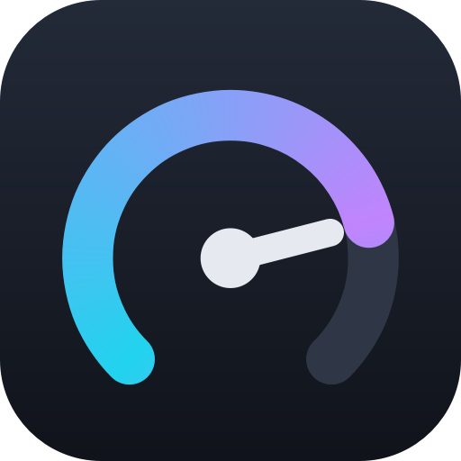
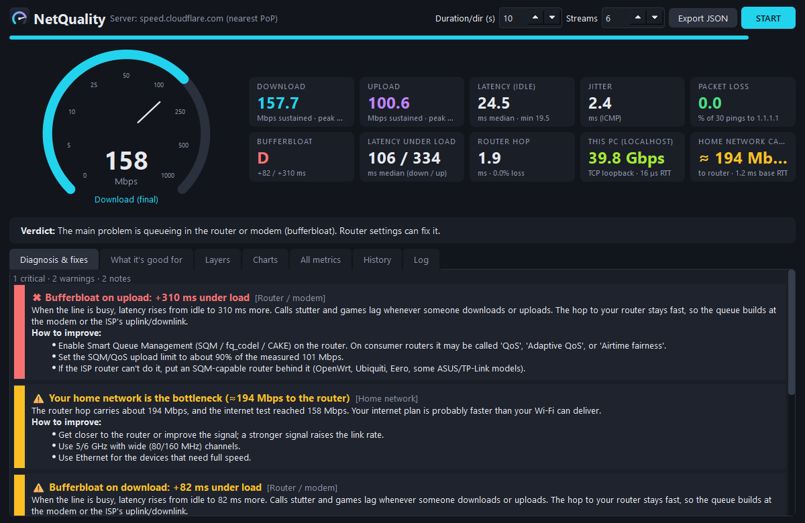
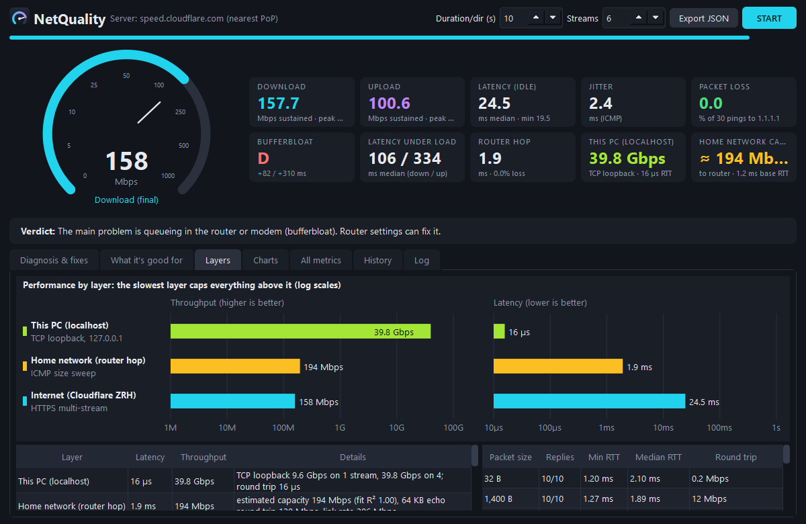
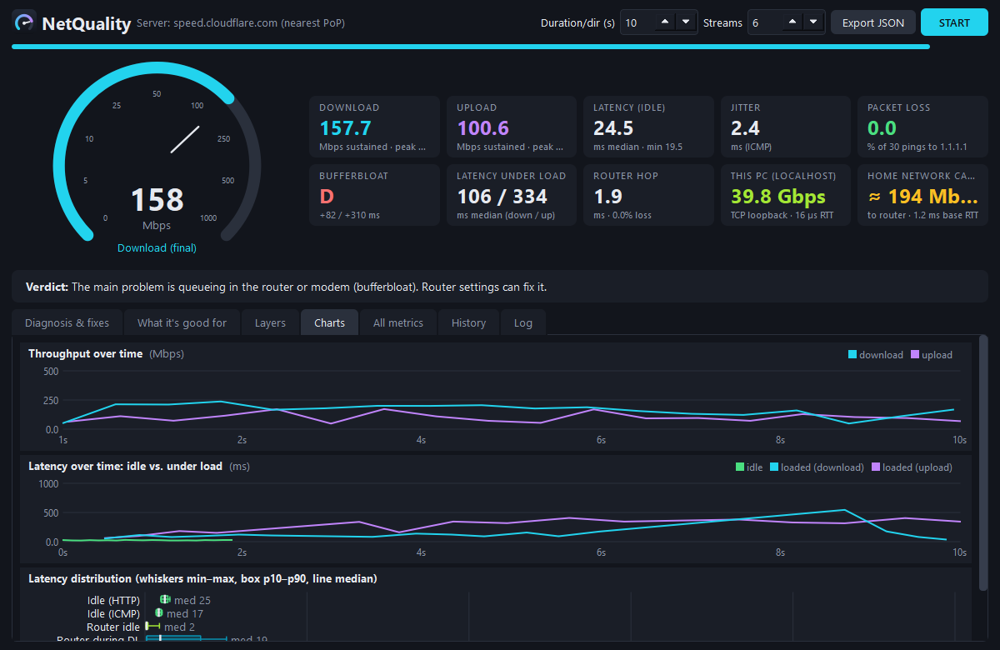
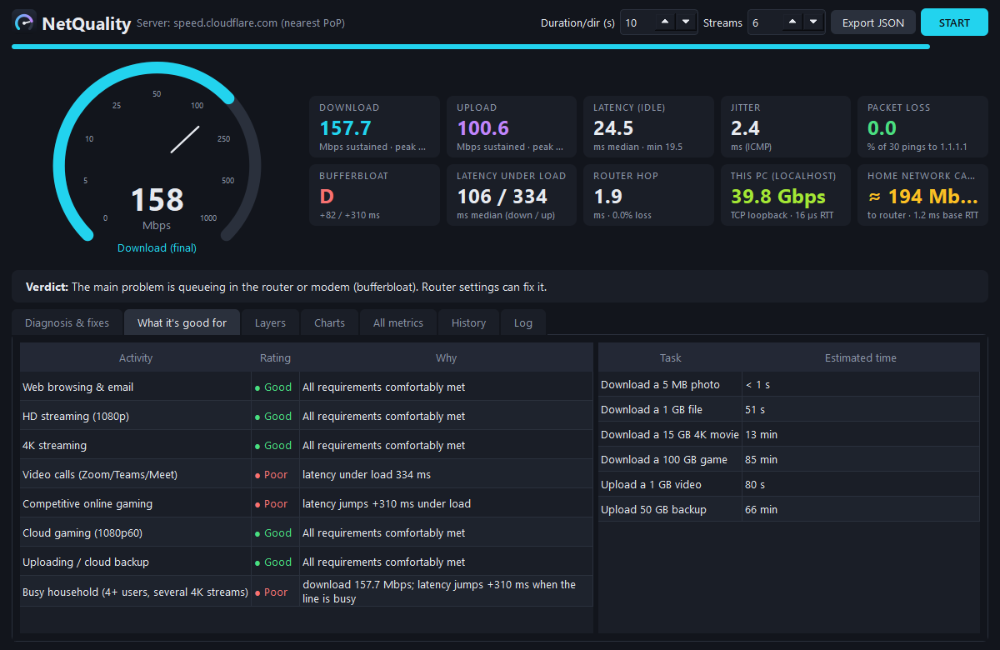

# NetQuality

A lightweight, ad-free desktop internet quality tester (PyQt6). It works like speedtest.net
and adds deeper metrics, plus a diagnosis of what's wrong and how to fix it.



<table>
<tr>
<td><br><b>Layers</b>: the slowest layer is your bottleneck</td>
<td><br><b>Charts</b>: throughput and latency (idle vs. under load)</td>
</tr>
<tr>
<td><br><b>What it's good for</b>: activities and transfer times</td>
<td></td>
</tr>
</table>

## Download

Windows users can grab the standalone `NetQuality.exe` from the
[latest release](https://github.com/gregaiello/netquality/releases/latest). No Python needed.

## Run from source

```powershell
python -m venv .venv
.venv\Scripts\pip install -r requirements.txt
.venv\Scripts\python run.py
```

## Build a standalone .exe

```powershell
.venv\Scripts\pip install pyinstaller
.venv\Scripts\pyinstaller netquality.spec --noconfirm
# -> dist\NetQuality.exe (single file, no console)
```

## What it measures

| Area | Metrics |
|---|---|
| This PC (localhost) | TCP loopback throughput (1 and N streams), TCP ping-pong RTT in µs, ICMP to 127.0.0.1: the ceiling of the PC's own network stack |
| Router hop sweep | ICMP echoes of 32 B to 64 KB: min/median RTT and loss per size; **estimated LAN/Wi-Fi capacity** from the RTT-vs-size slope (with R² confidence); 64 KB round-trip rate |
| Local link | Wi-Fi vs Ethernet, adapter, link rate, Wi-Fi SSID/band/channel/standard, RSSI & signal % |
| Router hop | ICMP latency, jitter, loss to the default gateway (idle **and under load**) |
| Idle latency | HTTP RTT (server time subtracted), ICMP ping to 1.1.1.1, server-observed TCP RTT, jitter, packet loss |
| Connection setup | DNS, TCP connect, TLS handshake, time to first byte, IPv4/IPv6, TLS version |
| DNS / reachability | cached and uncached resolver time, TCP connect time to Cloudflare/Google/Quad9/Microsoft/Amazon |
| Download / upload | sustained (after warm-up), overall, peak, p10/median/p90, stability score, ramp-up time, stream errors, server-side TCP retransmissions |
| Bufferbloat | latency under download/upload, increase vs idle, A+…F grade, and **where** the queue is (Wi-Fi/router vs modem/ISP) |

Results are interpreted in three tabs:
- **Diagnosis & fixes**: detected issues by severity, tagged *Home network / Router / ISP*, each with concrete steps to improve.
- **What it's good for**: suitability for browsing, streaming, video calls, gaming, cloud gaming, backups, and estimated transfer times.
- **Layers**: This PC → home network → internet, side by side on log scales; the slowest layer is your bottleneck.
- **Charts**: throughput and latency over time, plus latency distribution box plots.

History is stored locally in `~/.netquality/history.db` (exportable to CSV); each result can be exported to JSON.

## How it works

The test server is Cloudflare's public speed-test endpoints (`speed.cloudflare.com`, anycast to the
nearest PoP), the same ones https://speed.cloudflare.com uses. No account, no ads. ICMP on Windows
uses `IcmpSendEcho`, so no admin rights are needed. Only dependency: PyQt6.

A default test takes ~45 s. It transfers about 10 s of data at full speed in each direction
(e.g. ~250 MB in total at 100 Mbps down / 100 Mbps up).

The test engine runs in a separate process, so the UI stays smooth while the link is saturated.
The app icon is drawn in code (`paint_logo` in `netquality/widgets.py`); regenerate
`assets/netquality.ico` / `.png` with `.venv\Scripts\python tools\make_icon.py`.

## Tests

```powershell
.venv\Scripts\pip install pytest
.venv\Scripts\python -m pytest tests
```

## License

MIT. See [LICENSE](LICENSE).
